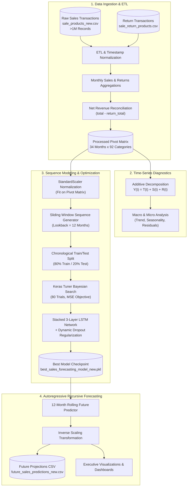
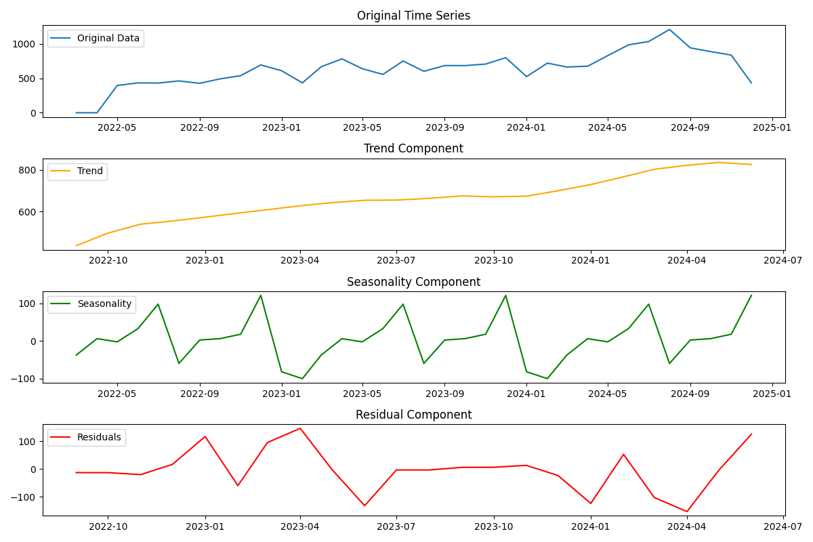
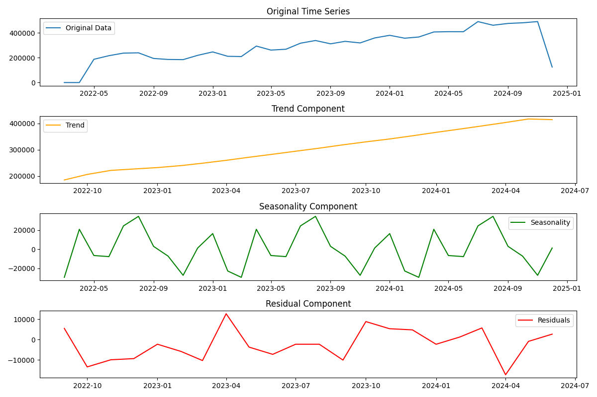
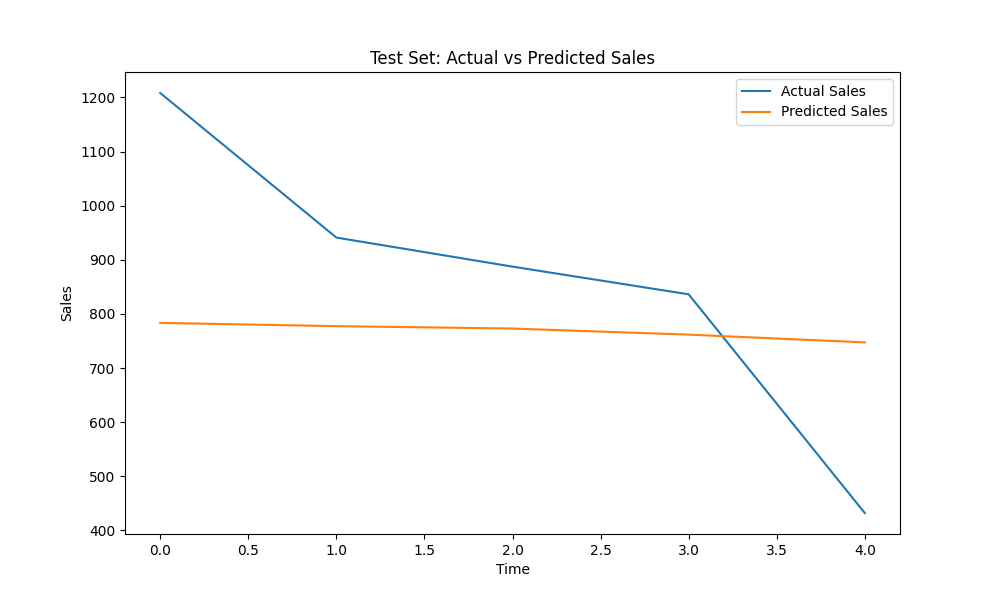
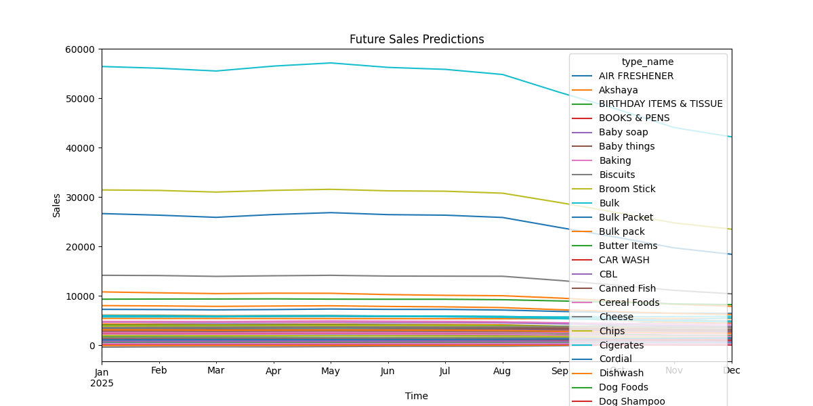

# 📈 Multi-Category Retail Sales & Demand Forecasting System

[](https://www.python.org/)
[](https://www.tensorflow.org/)
[](https://keras.io/keras_tuner/)
[](https://scikit-learn.org/)
[](https://www.statsmodels.org/)
[](https://github.com/)
[](https://opensource.org/licenses/MIT)

An enterprise-grade deep learning and time-series forecasting solution designed for large-scale retail demand planning. This system processes **over 1,000,000 transactional records**, reconciles multi-product sales with return logs to extract net revenue, performs seasonal time-series decomposition, and deploys a **Bayesian-optimized Stacked Long Short-Term Memory (LSTM)** neural network to forecast 12-month future demand across **92 distinct product categories** simultaneously.

---

## 📑 Table of Contents

- [Executive Summary](#-executive-summary)
- [System Architecture & Pipeline](#-system-architecture--pipeline)
- [Key Features](#-key-features)
- [Dataset & Data Engineering](#-dataset--data-engineering)
- [Time-Series Decomposition Analysis](#-time-series-decomposition-analysis)
- [Deep Learning Architecture & Bayesian Tuning](#-deep-learning-architecture--bayesian-tuning)
- [Forecasting Methodology & Evaluation](#-forecasting-methodology--evaluation)
- [Visual Gallery & Artifacts](#-visual-gallery--artifacts)
- [Repository Structure](#-repository-structure)
- [Installation & Quick Start](#-installation--quick-start)
- [Workflow & Usage Guide](#-workflow--usage-guide)
- [Hardware & Software Requirements](#-hardware--software-requirements)
- [Authors & Contact](#-authors--contact)
- [License](#-license)

---

## 🎯 Executive Summary

In high-volume retail, inaccurate demand forecasting causes either excessive holding costs and obsolescence or stockouts and lost revenue. Conventional single-series models (such as ARIMA or Holt-Winters) struggle to capture complex cross-category interdependencies, non-linear trends, and prolonged temporal lags across dozens of product lines.

This repository implements a **multi-variate, multi-output deep learning pipeline** that:
1. **Reconciles Gross vs. Net Demand**: Ingests raw point-of-sale transactions and credit/return slips, isolating true consumer consumption (`Net Sales = Gross Sales - Sales Returns`).
2. **Deconstructs Time Dynamics**: Applies additive time-series decomposition to isolate underlying secular trends from annual seasonality ($p=12$) and stochastic noise.
3. **Optimizes Deep Recurrent Networks**: Leverages **Bayesian Optimization via Keras Tuner** across 80 hyperparameter iterations to discover optimal LSTM cell topologies and dropout regularizations.
4. **Delivers Autoregressive Long-Horizon Forecasts**: Generates high-confidence, 12-month recursive multi-step projections across 92 product lines to drive procurement and replenishment cycles.

---

## 🏗️ System Architecture & Pipeline



---

## ✨ Key Features

- **High-Throughput ETL**: Efficiently processes $1.002\times 10^6$ raw transaction rows using vectorized Pandas operations.
- **Accurate Net Sales Modeling**: Accounts for product return dynamics, eliminating demand inflation in categories with high return rates.
- **Full-Spectrum Multi-Variate Forecasting**: Jointly models 92 retail categories simultaneously, preserving inter-category temporal dynamics and market-basket shifts.
- **Automated Bayesian Architecture Search**: Explores the neural network parameter space with Gaussian process surrogate models to converge on optimal configurations faster than random or grid searches.
- **Overfitting Prevention**: Utilizes Early Stopping on validation loss with automatic weight restoration, combined with multi-layer dropout (20% to 50%).
- **Autoregressive Recursive Projection**: Implements an iterative feedback window to forecast a complete 12-month forward business cycle without data leakage.

---

## 📊 Dataset & Data Engineering

### Input Data Sources
- **`sale_products_new.csv`**: Over 1,002,400 raw transactional line items detailing point-of-sale activities.
  - Columns: `sales_id`, `product_id`, `total`, `sales_date`, `product_name`, `pro_item_type_id`, `type_name`.
- **`sale_return_products.csv`**: Return slips and refunded product transactions.
  - Columns: `sales_return_id`, `product_id`, `total`, `sales_date`, `sales_id`.

### ETL and Data Transformation Workflow
1. **Datetime Parsing & Attribute Extraction**: Timestamps converted to `datetime64[ns]`, extracting temporal anchors (`year`, `month`).
2. **Multi-Level Aggregations**:
   - Gross Sales aggregated by `[year, month, type_name, product_id]`.
   - Returns aggregated by `[year, month, product_id]`.
3. **Outer Reconciliation & Imputation**:
   - Left join on `['year', 'month', 'product_id']`.
   - Null imputation (`fillna(0)`) on unreturned items.
   - Calculation: $\text{net\_total} = \text{total} - \text{return\_total}$.
4. **Time-Series Matrix Reshaping**:
   - Pivoted into a continuous temporal grid: rows represent discrete monthly intervals (`YYYY-MM-01`), columns represent 92 product categories (`Air Freshener`, `Biscuits`, `Bulk Packets`, `Cheese`, `Milk Powder`, `Vegetables`, etc.).
   - Output stored in [`data/pivot_data.csv`](file:///Users/ahryraj/personal_projects/Sales_prediction/data/pivot_data.csv).

---

## 🔬 Time-Series Decomposition Analysis

The historical series ($T = 34\text{ months}$) is decomposed using an **additive seasonal decomposition model** with annual periodicity ($m = 12$):

$$Y(t) = T(t) + S(t) + R(t)$$

Where:
- $Y(t)$: Observed monthly net revenue for a category (or aggregated store total).
- $T(t)$: Long-term secular trend (calculated via moving averages).
- $S(t)$: Periodic seasonal component repeating annually.
- $R(t)$: Irregular residual/noise component ($R(t) = Y(t) - T(t) - S(t)$).

Decomposition is performed at two granularities:
1. **Micro Category Level**: Isolates idiosyncratic shelf-life and seasonal surges (e.g., toiletries, confectionery, dry staples).
2. **Macro Aggregate Level**: Provides store-wide executive insights into total revenue trajectories and macro-economic retail trends.

---

## 🧠 Deep Learning Architecture & Bayesian Tuning

### Sequence Window Formulation
- **Lookback Window ($L$)**: 12 months.
- **Input Shape**: $(N, 12, 92)$ where $N$ is the number of sliding windows, 12 is the sequence length, and 92 is the feature dimension.
- **Target Vector ($y$)**: $(N, 92)$, representing the net sales across all 92 categories for the target month.
- **Data Scaling**: `StandardScaler` standardizes each category feature to zero mean and unit variance:
  $$z = \frac{x - \mu}{\sigma}$$

### Network Architecture
The predictive core is a **Deep Stacked Recurrent Neural Network (LSTM)**:

| Layer | Type | Configuration / Tunable Range | Regularization |
| :--- | :--- | :--- | :--- |
| **Input** | Sequence Input | Shape: `(12, 92)` | — |
| **LSTM 1** | Stacked LSTM | $32 \le \text{units} \le 128$ (Step: 16), `return_sequences=True` | Dropout: $0.2 \le p \le 0.5$ |
| **LSTM 2** | Stacked LSTM | $32 \le \text{units} \le 128$ (Step: 16), `return_sequences=True` | Dropout: $0.2 \le p \le 0.5$ |
| **LSTM 3** | Terminal LSTM | $32 \le \text{units} \le 128$ (Step: 16), `return_sequences=False`| Dropout: $0.2 \le p \le 0.5$ |
| **Output** | Dense | 92 units (Linear activation) | — |

### Bayesian Optimization Strategy
Instead of exhaustive grid searches, **Keras Tuner Bayesian Optimization** is configured:
- **Surrogate Model**: Gaussian Process modeling the validation loss objective function.
- **Exploration vs. Exploitation**: 80 trials with dynamic acquisition function balancing.
- **Learning Rate Range**: $1 \times 10^{-4}$ to $5 \times 10^{-3}$ on a logarithmic scale (`sampling='LOG'`).
- **Loss Metric**: Mean Squared Error (MSE).
- **Early Stopping**: Monitored on `val_loss` with a patience of 5 epochs and automatic rollback to the best checkpoint (`restore_best_weights=True`).

The optimal model topology and fitted scaler are serialized into [`models/best_sales_forecasting_model_new.pkl`](file:///Users/ahryraj/personal_projects/Sales_prediction/models/best_sales_forecasting_model_new.pkl).

---

## 🔮 Forecasting Methodology & Evaluation

### Validation & Metrics
The model is validated against an out-of-sample chronological test set:
- **Test Loss (MSE)**: Assesses point-wise variance minimization.
- **Coefficient of Determination ($R^2$ Score)**:
  $$R^2 = 1 - \frac{\sum_{i=1}^{n} (y_i - \hat{y}_i)^2}{\sum_{i=1}^{n} (y_i - \bar{y})^2}$$
  Measures the proportion of variance across categories explained by the recurrent network.

### 12-Month Recursive Autoregressive Forecasting
To forecast the upcoming calendar year (2025-01-31 to 2025-12-31):
1. The terminal lookback window $X_{T-12:T}$ is standardized and fed into the trained network.
2. The network predicts normalized sales vector $\hat{y}_{T+1}$ for all 92 categories.
3. The input window shifts forward by 1 step:
   $$X_{\text{next}} = [X_{2:12}, \hat{y}_{T+1}]$$
4. The procedure iterates 12 times to produce multi-step forward projections.
5. All predicted values are inverse-transformed back to monetary units via `scaler.inverse_transform()` and exported to [`data/future_sales_predictions_new.csv`](file:///Users/ahryraj/personal_projects/Sales_prediction/data/future_sales_predictions_new.csv).

---

## 🖼️ Visual Gallery & Artifacts

All visual diagnostics generated during execution are cataloged in the [`Graphs_new/`](file:///Users/ahryraj/personal_projects/Sales_prediction/Graphs_new) directory:

### 1. Product-Level Seasonal Decomposition
*Decomposition of historical time series for individual product lines into trend, seasonality, and residual components.*


### 2. Store-Wide Aggregate Sales Decomposition
*Macro-level decomposition across total store revenue, illustrating annual cyclicality and overall growth.*


### 3. Out-of-Sample Model Evaluation (Test Set)
*Direct comparison between actual test set sales and model predictions.*


### 4. 12-Month Multi-Category Forward Projections
*Future demand trajectories across high-volume and staple categories through 2025.*


---

## 📂 Repository Structure

```text
Sales_prediction/
├── data/
│   ├── sale_products_new.csv            # Raw sales transaction records (>1M rows)
│   ├── sale_return_products.csv         # Raw sales return records
│   ├── monthly_sales.csv                # Aggregated monthly sales by product
│   ├── monthly_returns.csv              # Aggregated monthly returns by product
│   ├── processed_sales_data.csv         # Reconciled net sales tabular dataset
│   ├── pivot_data.csv                   # Formatted multi-variate time-series pivot matrix
│   └── future_sales_predictions_new.csv # Exported 12-month recursive predictions
├── models/
│   ├── best_sales_forecasting_model_new.pkl  # Serialized best LSTM model & fitted scaler
│   └── tuner_new/                       # Keras Tuner Bayesian trial logs and checkpoints
├── Graphs_new/
│   ├── Figure_1.png                     # Micro category seasonal decomposition plot
│   ├── Figure_2.png                     # Macro aggregate seasonal decomposition plot
│   ├── Figure_3.png                     # Test set actual vs. predicted evaluation plot
│   └── Figure_4.png                     # 12-month multi-category future projection plot
├── Data_preprocessing.py                # ETL, return reconciliation, pivoting & decomposition
├── product_sales_prediction_new.py      # Sequence generator, Bayesian Tuner, LSTM training & inference
├── requirements.txt                     # Pinned project dependencies
└── README.md                            # Comprehensive system documentation
```

---

## 🚀 Installation & Quick Start

### 1. Prerequisites
- Python 3.10 or 3.11 recommended
- Virtual environment manager (`venv` or `conda`)

### 2. Clone Repository & Setup Virtual Environment
```bash
# Clone the repository
git clone https://github.com/AhryRaj/Sales_prediction.git
cd Sales_prediction

# Create and activate virtual environment
python3 -m venv venv
source venv/bin/activate  # On Windows: venv\Scripts\activate
```

### 3. Install Dependencies
```bash
pip install --upgrade pip
pip install -r requirements.txt
```

---

## 💻 Workflow & Usage Guide

### Step 1: Data Ingestion & Preprocessing
To clean raw transactions, reconcile return slips, construct the time-series matrix, and generate decomposition diagnostics:
```bash
python Data_preprocessing.py
```
**Outputs Generated**:
- `data/monthly_sales.csv`
- `data/monthly_returns.csv`
- `data/processed_sales_data.csv`
- `data/pivot_data.csv`
- Interactive visual decomposition figures (Figures 1 & 2)

### Step 2: Model Training, Bayesian Tuning & Inference
To execute the Bayesian optimization search (or load the saved model), evaluate test metrics, and project 12 months ahead:
```bash
python product_sales_prediction_new.py
```
**Outputs Generated**:
- `models/best_sales_forecasting_model_new.pkl` (Best model weights + scaler)
- `models/tuner_new/` (Hyperband/Bayesian trial telemetry)
- `data/future_sales_predictions_new.csv` (12-month future forecast dataframe)
- Evaluation and forecasting charts (Figures 3 & 4)

---

## 📦 Hardware & Software Requirements

| Dependency | Version | Purpose |
| :--- | :--- | :--- |
| **Python** | `>= 3.10` | Base runtime environment |
| **TensorFlow** | `== 2.18.0` | Deep learning backend & LSTM layers |
| **Keras Tuner** | `== 1.4.7` | Bayesian hyperparameter optimization engine |
| **Scikit-Learn** | `== 1.4.2` | Preprocessing (`StandardScaler`) & Metrics ($R^2$) |
| **Pandas** | `== 2.2.3` | Vectorized transactional ETL & multi-index pivoting |
| **NumPy** | `== 2.2.1` | Sliding window sequence tensor manipulation |
| **Statsmodels** | `== 0.14.2` | Classical time-series additive decomposition |
| **Matplotlib** | `== 3.8.4` | Statistical graphing & forecast visualization |

---

## 👨‍💻 Authors & Contact

**Ahryraj Varatharaja**  
- **Email**: [varaahry2000@gmail.com](mailto:varaahry2000@gmail.com)  
- **GitHub**: [AhryRaj/Sales_prediction](https://github.com/AhryRaj/Sales_prediction)  

---

## 📄 License

This project is licensed under the **MIT License** — feel free to modify, distribute, and integrate into commercial or academic applications. See the LICENSE file for details.
